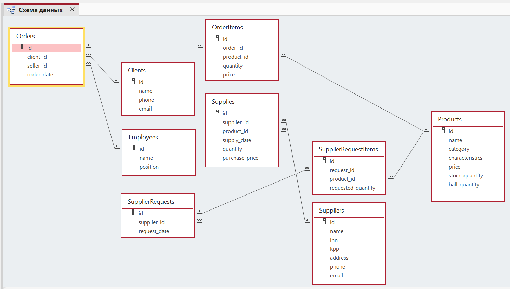

# База данных оптового магазина игрушек

**Учебная практическая работа «Проектирование базы данных»**, МГТУ им. Н. Э. Баумана, 2025 год. Проект выполнен в Microsoft Access с использованием SQL (диалект Access/ACE).

## Цель и предметная область

Цель работы — спроектировать и реализовать реляционную базу данных для информационной системы оптового магазина игрушек. В исходном задании предусматривались учет товаров и их остатков, хранение информации о поставщиках, поставках, клиентах, сотрудниках и заказах, определение цен и сумм покупки, а также формирование заявок поставщикам при нехватке товаров.

Магазин использует склад и торговый зал. Сотрудник оформляет заказ клиента; заказ содержит одну или несколько товарных позиций. Поставки связывают товары с поставщиками. В базе предусмотрен учет заявок поставщикам на закупку товаров. Каждая заявка содержит сведения о поставщике, дате оформления и перечне заказываемых товаров с указанием необходимого количества.

## Модель данных

Реализовано **9 таблиц и 9 связей типа «один ко многим»**. Для идентификации записей используются первичные ключи `id`, а для соединения таблиц — внешние ключи. Для связей между таблицами настроено обеспечение ссылочной целостности. Для составов заказов и заявок поставщикам предусмотрено каскадное удаление: при удалении заказа или заявки автоматически удаляются соответствующие записи из OrderItems или SupplierRequestItems. Сведения о самих товарах в Products при этом сохраняются.



### Таблицы

| Таблица | Основные поля | Назначение |
|---|---|---|
| `Clients` | `id`, `name`, `phone`, `email` | Сведения о покупателях |
| `Employees` | `id`, `name`, `position` | Сотрудники, в том числе продавцы |
| `Products` | `id`, `name`, `category`, `characteristics`, `price`, `stock_quantity`, `hall_quantity` | Товары, характеристики, цены, остатки на складе и в зале |
| `Suppliers` | `id`, `name`, `inn`, `kpp`, `address`, `phone`, `email` | Контактные данные и реквизиты поставщиков |
| `Supplies` | `id`, `supplier_id`, `product_id`, `supply_date`, `quantity`, `purchase_price` | История поступления товара от поставщика и закупочная цена |
| `Orders` | `id`, `client_id`, `seller_id`, `order_date` | Заказы, их клиенты, продавцы и даты |
| `OrderItems` | `id`, `order_id`, `product_id`, `quantity`, `price` | Товары в заказе, количество и цена на момент продажи |
| `SupplierRequests` | `id`, `supplier_id`, `request_date` | Заявки поставщикам |
| `SupplierRequestItems` | `id`, `request_id`, `product_id`, `requested_quantity` | Товары и требуемые количества в заявке |

### Основные связи

- `Clients` → `Orders`: один клиент может оформить несколько заказов.
- `Employees` → `Orders`: один продавец может оформить несколько заказов.
- `Orders` → `OrderItems` и `Products` → `OrderItems`: один заказ содержит несколько позиций, товар может встречаться в разных заказах.
- `Suppliers` → `Supplies` и `Products` → `Supplies`: каждая поставка связывает поставщика с конкретным товаром.
- `Suppliers` → `SupplierRequests`: одному поставщику могут направляться несколько заявок.
- `SupplierRequests` → `SupplierRequestItems` и `Products` → `SupplierRequestItems`: заявка содержит перечень товаров.

## Что реализовано

 - Спроектирована реляционная модель базы данных из 9 взаимосвязанных таблиц. Выполнена нормализация данных, определены первичные и внешние ключи, настроены ограничения ссылочной целостности.
- Реализовано хранение информации о товарах, поставщиках, поставках, клиентах, сотрудниках, заказах и заявках на закупку.
- Разработаны SQL-запросы для поиска и фильтрации данных, объединения таблиц, проверки остатков товаров, расчета стоимости заказов и анализа покупательской активности.
- Использованы операции `SELECT`, `JOIN`, `WHERE`, `GROUP BY`, `HAVING`, `SUM`, а также `INSERT`, `UPDATE` и `DELETE` для изменения данных.

### Пример аналитического запроса

Следующий запрос находит клиентов, оформивших **более одного заказа** у указанного продавца в мае 2025 года:

```sql
SELECT Clients.name AS ClientName,
       COUNT(Orders.id) AS PurchaseCount
FROM (Clients INNER JOIN Orders
      ON Clients.id = Orders.client_id)
INNER JOIN Employees
      ON Orders.seller_id = Employees.id
WHERE Employees.name = "Джим Халперт"
  AND Orders.order_date >= #2025-05-01#
  AND Orders.order_date < #2025-06-01#
GROUP BY Clients.id, Clients.name
HAVING COUNT(Orders.id) > 1;
```

На демонстрационных данных после добавления второго заказа для Майкла Скотта запрос вернул `PurchaseCount = 2`. Здесь считается количество **заказов**, а не число единиц товара. SQL-код остальных запросов находится в `sql/select_queries.sql`.

## Структура репозитория

```text
wholesale-store-database/
├── README.md               # Документация в формате README
├── .gitignore              # Исключения для временных файлов
├── database/
│   └── Database1.accdb     # Актуальная база
├── docs/
│   └── er_diagram.png      # Схема связей из Microsoft Access
└── sql/
    ├── schema.sql          # Определения таблиц и внешних ключей
    ├── select_queries.sql  # Запросы на чтение и анализ
    └── data_operations.sql # Запросы, изменяющие данные
```

## Как ознакомиться с проектом

**Без Microsoft Access:** посмотрите схему связей выше и файлы в `sql/` прямо на GitHub. Они позволяют оценить модель данных и используемые SQL-конструкции.

**С Microsoft Access (Windows):** скачайте репозиторий, откройте `database/Database1.accdb`, просмотрите таблицы и запросы, а также окно **Работа с базами данных → Схема данных**. Для экспериментов с изменением данных работайте с копией файла.

**Восстановление структуры базы из SQL:** файл sql/schema.sql содержит команды создания таблиц и настройки связей. Схема восстановлена на основе структуры оригинальной базы Microsoft Access. SQL-файлы предназначены для изучения структуры и запросов, но не предназначены для полного восстановления ее содержимого. Готовая база с заполненными таблицами находится в database/Database1.accdb.

**Внимание:** `data_operations.sql` содержит запросы `INSERT`, `UPDATE`, `DELETE` с конкретными демонстрационными значениями. Не запускайте файл целиком в основной базе и не выполняйте запросы повторно без проверки: это может создавать дубликаты или удалять записи.

## Особенности реализации

- Используется диалект SQL для Microsoft Access: `AUTOINCREMENT`, `CURRENCY`, `IIf`, литералы дат `#...#` и другие конструкции могут отличаться от PostgreSQL и MySQL.
- Цена товара (`Products.price`) и закупочная цена поставки (`Supplies.purchase_price`) — разные показатели.
- Данные проекта учебные и вымышленные.
- Проект представляет собой базу данных и набор запросов, **а не веб-приложение**.
